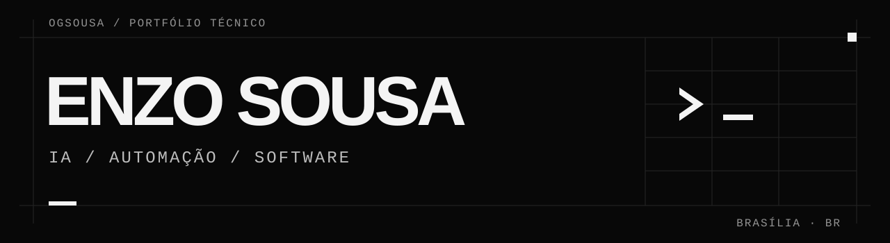

Construo agentes, automações e aplicações web que conectam APIs, bancos de dados e operações reais. Trabalho da interface à lógica do sistema, incluindo integração e deploy.

### Projetos selecionados

- **[Hearts](https://github.com/ogsousa/hearts)** — Prospecção, decisões rastreáveis e tratamento de falhas. Núcleo TypeScript sanitizado, demo e testes offline.
- **[Neovian OS](https://github.com/ogsousa/neovian-os)** — CRM, pipeline, agenda, clientes e tarefas. Case técnico e arquitetura do produto interno.
- **[Atendimento multiagente](https://github.com/ogsousa/ai-customer-service)** — WhatsApp, Instagram, ferramentas especializadas e encaminhamento humano. Arquitetura e limites de integração.
- **[Automation Workflows](https://github.com/ogsousa/automation-workflows)** — Classificação de eventos e conteúdo por canal. Exemplos derivados de n8n e testes com dados sintéticos.
- **[Moreira Veículos](https://github.com/ogsousa/moreira-veiculos)** — Catálogo, gestão de estoque e captação de oportunidades. Case técnico da aplicação.
- **[Portfólio](https://github.com/ogsousa/portfolio)** — Experiências web, IA e sistemas em uma interface própria. Frontend em Next.js e TypeScript.

### Tecnologias

**Aplicações** · Node.js, TypeScript, React, Next.js 
**Dados e integração** · PostgreSQL, Supabase, APIs, webhooks 
**Automação** · n8n, agentes de IA, RAG, workers

Publico código executável quando o recorte é seguro e cases técnicos quando a implementação pertence a uma operação privada. Os READMEs distinguem o que está implementado, o que foi validado localmente e o que ainda depende de integração real.

Brasília, Brasil · [Projetos](https://github.com/ogsousa?tab=repositories) · [Portfólio — código](https://github.com/ogsousa/portfolio)
